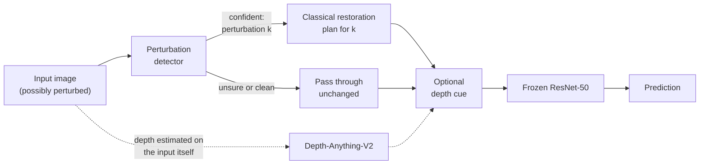
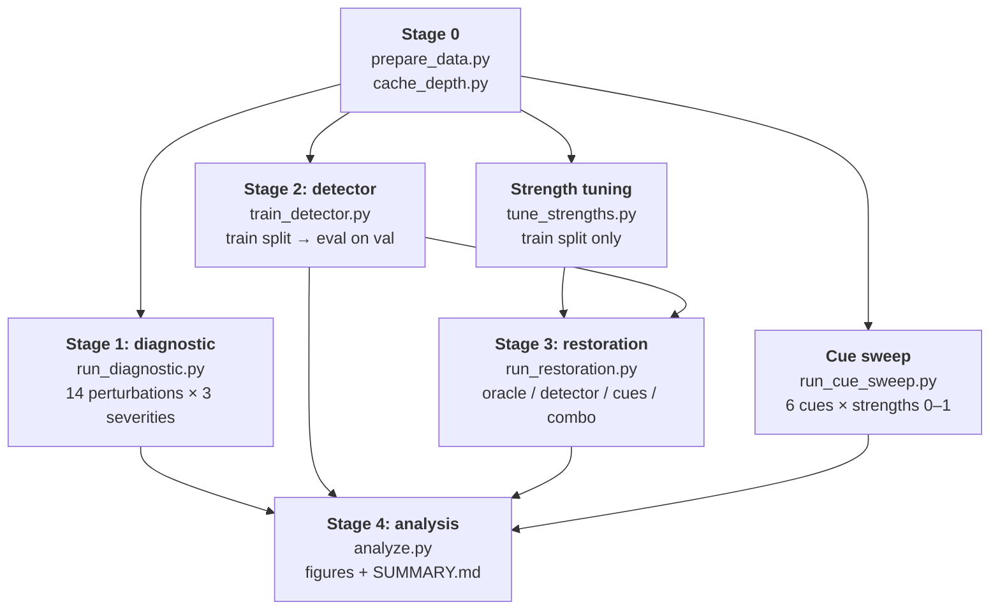
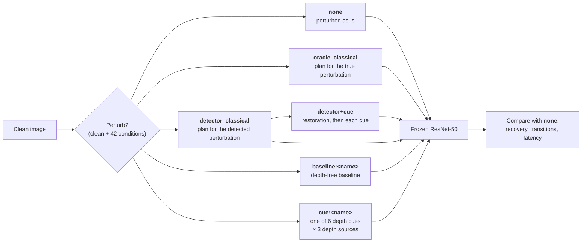

# Bolero: recovering entity context under pixel-level perturbation

CSE 598: Operationalizing Deep Learning (Fall 2026), group project.

**Team:** Rohith Khanna Sridhar, Venkat Tummala, Arvind Kaushik, Sachin Venugopalan Nair, Khushi Prashant Thakare

---

## Contents

1. [The question](#the-question)
2. [System overview](#system-overview)
3. [Pipeline stages](#pipeline-stages)
4. [Method details](#method-details)
5. [Setup](#setup)
6. [Running the pipeline](#running-the-pipeline)
7. [Outputs](#outputs)
8. [Decision engine: Jev and OpenRouter](#decision-engine-jev-and-openrouter)
9. [VLM evidence and manual review](#vlm-evidence-and-manual-review)
10. [Repository layout](#repository-layout)
11. [Earlier result: the depth-layer reconstruction audit](#earlier-result-the-depth-layer-reconstruction-audit)
12. [Known gaps and limitations](#known-gaps-and-limitations)
13. [Generative AI disclosure](#generative-ai-disclosure)

---

## The question

A deployed vision model sees blurred, compressed, occluded, badly lit and noisy
images. Each of these strips out evidence the recognizer needs. We study
**disruptive but non-destructive perturbations** and ask four questions:

1. **How much recognition does a frozen classifier lose** under each perturbation, and at what severity?
2. **Can we detect the perturbation** from the image alone, without flagging clean inputs?
3. **Can lightweight preprocessing win recognition back** without retraining the classifier? We test classical restoration and depth-derived contextual cues against simple depth-free baselines, and check whether the depth map itself is what helps.
4. **What does that preprocessing cost?** We measure harm on clean inputs, prediction instability and latency.

We compare methods on recognition retention and recovery, prediction stability
and added computation, with no single pass/fail threshold.

| Component | Choice |
|---|---|
| System under test | `microsoft/resnet-50`, ImageNet-1k, **frozen** (never trained or fine-tuned) |
| Depth model | `depth-anything/Depth-Anything-V2-Small-hf` (monocular relative depth) |
| Evaluation data | Imagenette2-160 validation split, 3,925 images, 10 classes |
| Detector training data | Imagenette2-160 train split (disjoint from evaluation) |

---

## System overview

We evaluate a preprocessing stage that sits in front of an unchanged classifier:



The detector is **conservative**. It sends an image to restoration when it names a
perturbation with probability of 0.6 or more (the default threshold). Anything below
that passes through untouched, so restoration can't damage a clean input that needed
no help.

Restoration never sees the clean image or its depth map. The cues re-estimate depth
on whatever image arrives, as a deployed system would have to. Stage 3 also reruns
each cue with the clean image's depth (an idealized upper bound) and with an
unrelated image's depth (a control), and reports those separately.

---

## Pipeline stages



| Stage | Script | Question it answers | Key metrics |
|---|---|---|---|
| 0 | `prepare_data.py`, `cache_depth.py` | Is the data in place? | Image counts |
| 1 | `run_diagnostic.py` | What does each perturbation do to the classifier? | Accuracy, prediction-change rate, correct→wrong and wrong→correct counts, confidence shift, ECE, PSNR/SSIM |
| 2 | `train_detector.py` | Can the perturbation be identified from the image alone? | Top-1 detection accuracy, routed-correctly rate, clean false-alarm rate |
| - | `tune_strengths.py` | Which strength should each cue and baseline use? (train split) | Dev accuracy on perturbed inputs, accuracy lost on clean inputs |
| 3 | `run_restoration.py` | Does preprocessing win recognition back, at what cost, and does depth add anything over simple baselines? | Accuracy vs. ground truth, agreement with the clean prediction, fixes and breaks, recovery rate, latency |
| - | `run_cue_sweep.py` | At what strength does each cue start changing clean predictions? (train split) | Prediction-change rate vs. strength |
| 4 | `analyze.py` | Summarize everything | Figures in `results/figures/`, `results/SUMMARY.md` |

### What happens to each image in Stage 3

For each validation image, Stage 3 takes the clean image and its 42 perturbed
versions (14 perturbations × 3 severities) and runs each one through every method:



- **`oracle_classical`** sets the upper bound: the script hands it the perturbation we applied.
- **`detector_classical`** is the deployable version.
- **`baseline:<name>`** applies unsharp masking, auto-contrast or CLAHE to every input, without depth. These measure what depth adds over simple preprocessing.
- **`cue:<name>`** runs with three depth maps (`depth_source` column): `perturbed` (re-estimated on the input; the main result), `clean` (idealized) and `mismatched` (another class's image; a control).
- **`detector+cue:<name>`** runs for every cue, so each component's contribution shows up separately.
- **The `clean` rows** price a false alarm: they show what each method does to an image that needed no help.

---

## Method details

### The 14 perturbations

Defined in [`src/bolero/perturbations.py`](src/bolero/perturbations.py). Each has three
severity levels and is deterministic per (image, perturbation, level).

| Perturbation | Family | Severity levels (1 → 3) | Effect |
|---|---|---|---|
| `region_removal` | occlusion | area 0.10 / 0.20 / 0.35 | One random rectangle set to black |
| `inversion` | color | blend 0.70 / 0.85 / 1.00 | Blend toward the color negative |
| `grayscale` | color | blend 0.50 / 0.75 / 1.00 | Blend toward luminance |
| `low_contrast` | photometric | factor 0.50 / 0.30 / 0.15 | Compress around the global mean |
| `darken` | photometric | factor 0.60 / 0.40 / 0.20 | Scale intensities down |
| `brighten` | photometric | factor 0.60 / 0.40 / 0.20 | Scale toward white |
| `gaussian_blur` | blur | σ 1.0 / 2.0 / 3.5 | Whole-image blur |
| `gaussian_noise` | noise | σ 0.04 / 0.08 / 0.16 | Additive sensor-like noise |
| `jpeg_compression` | compression | quality 30 / 15 / 5 | Block artifacts |
| `boundary_blur` | boundary | top 10 / 20 / 35 % of depth edges | Blur the entity outline |
| `boundary_erase` | boundary | top 5 / 10 / 20 % of depth edges | Replace the outline with gray |
| `foreground_blur` | depth-selective | σ 2 / 4 / 6 on the nearest 40 % | Blur the entity, keep the context |
| `foreground_occlusion` | depth-selective | nearest 10 / 20 / 35 % | Gray out the entity, keep the context |
| `background_removal` | depth-selective | farthest 30 / 50 / 70 % | Gray out the context, keep the entity |

Boundary and depth-selective perturbations use the clean image's depth map to find
the entity, which makes them the adversarial half of the study. Restoration never
gets that map.

**Held-out stress test.** `rand_augment` applies torchvision's
[RandAugment](https://docs.pytorch.org/vision/main/generated/torchvision.transforms.RandAugment.html)
(2 random ops at magnitude 6 / 12 / 18 out of 30). It runs in Stages 1 and 3 but is
never used to train the detector or tune strengths, and it has no oracle plan. It
measures how the system handles distortions it was not built for, and it is
reported separately from the 14-perturbation headline numbers.

### The 6 contextual cues ("forced depth perception")

"Forced depth perception" in the project title names the whole approach, not a
seventh operation: estimate a depth map, derive structure from it, and write that
structure back into the RGB image the classifier sees. The six cues below are the
concrete operations. They are defined in [`src/bolero/cues.py`](src/bolero/cues.py).

**Inputs, shared by every cue.** These are the RGB image *x* (H×W×3 in [0, 1]), the
strength *s* in [0, 1] (0 is identity), and a depth map *D* (H×W in [0, 1], 1 =
nearest). *D* comes from Depth-Anything-V2-Small run on the input itself. It is
relative inverse depth, normalized per image between its 2nd and 98th
percentiles, so it orders pixels by nearness and has no metric scale. Two values
are derived from *D*:

- *B*, the boundary strength: |∇D| / max|∇D|, in [0, 1].
- *E*, the edge band: *B* blurred with σ = 1, then normalized to its 99.5th percentile.

Every output is clipped to [0, 1].

| Cue | Transformation | What it is meant to preserve or recover |
|---|---|---|
| `border_strengthening` | *x* · (1 + *s*·*B*) | Brightens the entity outline, where depth changes fastest. Aims to restore shape evidence lost to blur or erased edges. |
| `depth_boundary_emphasis` | *x* · (1 − *s*·*E*) | Draws a dark outline along depth edges. Same goal as above, with a contour instead of a highlight. |
| `entity_background_separation` | *x* · ((1 − *s*) + *s*·*M*), where *M* = 0.6·norm(*D*) + 0.4·*B*, scaled to max 1 | Dims far, edge-free regions. Aims to suppress distracting context and keep the entity. |
| `shadow_reinforcement` | *x* · (1 − *s*·(1 − *D*)) | Darkens pixels in proportion to their distance, like a depth-dependent shadow. Aims to make figure/ground ordering visible after contrast or color loss. Despite the name, it computes no physical shadows. |
| `contrast_luminance` | (1 − *w*)·*x* + *w*·CLAHE(*x*), where *w* = *s*·(0.5 + 0.5·*D*) | Equalizes local contrast in Lab lightness (clip limit 2, 4×4 tiles), more strongly on near regions. Aims to recover texture under darkening, brightening and low contrast. |
| `thermal_injection` | (1 − *s*)·*x* + *s*·inferno(*D*) | Blends a false-color rendering of the depth map into the image. "Thermal" names the look only: it is a colormap of estimated depth, not infrared data. It tests whether depth layout alone carries class evidence. The pilot showed it changes predictions at almost every strength, so we treat it as a probe, not a restoration. |

**Strengths.** `scripts/tune_strengths.py` sweeps each cue over {0.1, 0.2, 0.3, 0.5,
0.75, 1.0} on perturbed and clean images from the **train** split, with depth
re-estimated on each perturbed input. For every cue it keeps the strength with the
best mean accuracy over all perturbation × severity conditions, among strengths
that cost at most 1 pp of accuracy on clean images. If no strength meets that
limit, it keeps the one with the smallest clean-image cost and flags it. The
choices are frozen in `results/tuning/strengths.json` before Stage 3 runs on val.
One strength serves all perturbations, because a deployed system doesn't know
which perturbation it faces. The hand-set fallbacks in `cues.DEFAULT_STRENGTH`
apply only if that file is missing.

### Depth-free baselines

Defined in [`src/bolero/baselines.py`](src/bolero/baselines.py). They are applied
blindly to every input, tuned on the train split by the same rule as the cues,
and each is the depth-free counterpart of one or more cues:

| Baseline | Transformation | Depth-based counterpart |
|---|---|---|
| `unsharp` | Unsharp mask, σ = 2, amount 2*s* | `border_strengthening`, `depth_boundary_emphasis` |
| `autocontrast` | Blend toward a global auto-levels stretch | `shadow_reinforcement` |
| `clahe` | (1 − *s*)·*x* + *s*·CLAHE(*x*), uniform weight | `contrast_luminance` (identical except for the depth weighting) |

### Depth sources: is it the depth?

Each cue runs three times in Stage 3, and the `depth_source` column records which run is which:

| `depth_source` | Depth map | Role |
|---|---|---|
| `perturbed` | Re-estimated on the perturbed input | Main result; deployable |
| `clean` | Estimated on the clean image | Idealized comparison: what the cue could do if the perturbation didn't also damage depth |
| `mismatched` | Clean depth of an image from another class, resized | Control: a gain here comes from the image operation, not from depth information |

Per-input depth reliability is the Spearman correlation between perturbed and
clean depth (`depth_rank_corr`). Rank correlation suits relative depth, which has
no fixed scale or offset. `analyze.py` bins it into quartiles to test whether
restoration failures coincide with unreliable depth.

### Classical restoration plans

Defined in [`src/bolero/restoration.py`](src/bolero/restoration.py). There is one plan per perturbation:

| Perturbations | Restoration plan |
|---|---|
| `region_removal`, `boundary_erase`, `foreground_occlusion`, `background_removal` | Detect the constant-fill mask, then Telea inpainting |
| `low_contrast`, `darken`, `brighten` | Global auto-levels (same stretch for all channels) |
| `inversion` | Invert, then auto-levels |
| `gaussian_blur`, `boundary_blur`, `foreground_blur` | Unsharp mask |
| `gaussian_noise` | Estimate noise level, then non-local-means denoising |
| `jpeg_compression` | Bilateral filter (deblocking) |
| `grayscale` | None: color is gone, so the image passes through |

### The perturbation detector

Defined in [`src/bolero/detection.py`](src/bolero/detection.py).

- **Features:** 45 hand-crafted image statistics. They cover luminance percentiles, channel statistics, saturation, constant-fill fractions, Laplacian and gradient energy, a noise estimate, JPEG 8×8 blockiness, dark/bright-channel means, and luminance and hue histograms.
- **Model:** a random forest with 400 trees and balanced class weights. It predicts one of 15 labels: `clean` or one of the 14 perturbations.
- **Training:** perturbed copies of **train**-split images. Evaluation uses **val**-split images, so the detector never sees evaluation images.
- **Decision rule:** restore only if the top label is not `clean` and its probability is at least the threshold.

### Metrics

Defined in [`src/bolero/metrics.py`](src/bolero/metrics.py).

| Metric | Definition |
|---|---|
| Top-1 accuracy | 1000-way argmax equals the Imagenette class's ImageNet index (ground truth) |
| Agreement with clean prediction | `agree_clean_before/after`: top-1 equals the classifier's prediction on the clean image. This differs from accuracy because the clean prediction is wrong for ~20 % of images |
| Fixes and breaks | `wrong_to_correct` / `fix_rate` (share of wrong inputs fixed) and `correct_to_wrong` / `break_rate` (share of correct inputs broken), vs. ground truth, per perturbation × severity |
| Back to clean prediction | `back_to_clean_pred`: changed to agree with the clean prediction; `back_to_clean_pred_wrong`: did so but is still wrong |
| Depth reliability | `depth_rank_corr`: Spearman correlation of perturbed-input depth with clean depth |
| Prediction-change rate | Fraction of images whose top-1 label differs from the reference condition |
| Transitions | Counts of correct→wrong and wrong→correct vs. the reference |
| Recovery rate | (acc_restored − acc_perturbed) / (acc_clean − acc_perturbed). This is the fraction of the loss won back. |
| Confidence / true-class probability shift | Mean change in softmax confidence and in the true-class probability |
| ECE | Expected calibration error, 15 bins |
| PSNR / SSIM | Image fidelity vs. the clean image |
| Latency | Per-image milliseconds for restoration (including detection and depth) and for classification |

---

## Setup

Requires **Python 3.10+**. GPU is optional: the code selects CUDA, then Apple MPS, then CPU.

```bash
git clone https://github.com/sumonesphantom/CSE_598_ODL_project.git
cd CSE_598_ODL_project

python3 -m venv .venv && source .venv/bin/activate
pip install -r requirements.txt
pip install -e .          # optional: scripts also work without installing
```

**Data.** `prepare_data.py` looks for Imagenette2-160 in three places, in order:
`$IMAGENETTE_ROOT`, then `./data/imagenette2-160`, then
`../clip_corruption_calibration/data/imagenette2-160`. If it finds none, it
downloads the dataset (about 94 MB) into `./data`.

```bash
python scripts/prepare_data.py
# or point at an existing copy:
export IMAGENETTE_ROOT=/path/to/imagenette2-160
```

**Models.** The scripts download ResNet-50 (about 100 MB) and Depth-Anything-V2-Small
(about 100 MB) from Hugging Face on first use. The VLM evaluation also downloads
`Qwen/Qwen2.5-VL-3B-Instruct` (about 6 GB). Hugging Face caches them in
`~/.cache/huggingface`.

**OpenRouter.** The decision-engine comparison needs an OpenRouter key. Copy
`.env.example` to `.env` and set `OPENROUTER_API_KEY`. The key is gitignored and is
never written to a cache or a log. A full comparison of five hosted models costs
well under one dollar.

**Tests.** The 197 unit tests run on synthetic images and need no model download:

```bash
pytest
```

---

## Running the pipeline

### One command

```bash
scripts/run_all.sh quick   # 5 images/class, end-to-end, a few minutes
scripts/run_all.sh full    # all 3,925 val images for Stage 1, 50/class for Stage 3
```

### Stage by stage

```bash
python scripts/cache_depth.py                     # optional: precompute clean depth for all val images
python scripts/run_diagnostic.py                  # Stage 1 (add --per-class N to subsample)
python scripts/train_detector.py                  # Stage 2
python scripts/tune_strengths.py --per-class 10   # choose strengths on the train split
python scripts/run_restoration.py --per-class 50  # Stage 3 (val split)
python scripts/run_cue_sweep.py --per-class 50    # cue stability on clean train images
python scripts/analyze.py                         # figures + results/SUMMARY.md

# decision engine and VLM (320 px; Jev needs OPENROUTER_API_KEY in .env)
python scripts/prepare_data.py --version 320
python scripts/probe_resolutions.py
python scripts/run_decider_compare.py --help
python scripts/run_vlm_eval.py --help
python scripts/make_vlm_review.py --help
```

Useful flags (every script takes `--help`):

| Flag | Scripts | Purpose |
|---|---|---|
| `--per-class N` | all stages | Subsample N images per class |
| `--perturbations a b ...` | diagnostic, restoration | Run a subset of perturbations |
| `--cues a b ...` | restoration, cue sweep | Run a subset of cues |
| `--baselines a b ...` | tuning, restoration | Run a subset of depth-free baselines |
| `--combo-cues a b ...` | restoration | Cues applied after detector restoration (default: all; none to skip) |
| `--depth-sources ...` | restoration | Any of `perturbed clean mismatched` (default: all three) |
| `--strengths PATH` | restoration | Tuned strengths file (default `results/tuning/strengths.json`) |
| `--max-clean-drop PP` | tuning | Clean-accuracy budget for choosing a strength (default 1 pp) |
| `--threshold T` | train_detector | Detector confidence threshold |
| `--device {cuda,mps,cpu}` | model stages | Force a device |
| `--out DIR` | all stages | Output directory |

### Approximate runtimes (Apple M4 Pro, MPS)

| Stage | Cost | Full run |
|---|---|---|
| Clean depth, first time only | ~0.2 s / image | ~15 min for 3,925 images |
| Stage 1: diagnostic | ~0.3 s / image (42 conditions) | ~20 min for 3,925 images |
| Stage 2: detector | ~30 s at 5/class, scales linearly | a few minutes at 40/class |
| Strength tuning | not yet timed at full size (6 strengths × 9 methods per condition) | |
| Stage 3: restoration | ~2.8 s / image in a 3-perturbation smoke run; slower than before because it adds 3 baselines, 3 depth sources and 6 combinations per condition | not yet timed at full size |
| Cue sweep | ~0.5 s / image | ~4 min at 50/class |

---

## Outputs

```
results/
├── diagnostic/
│   ├── records.csv.gz      one row per image × perturbation × severity   (gitignored)
│   ├── summary.csv         per perturbation × severity
│   ├── per_class.csv       per perturbation × severity × class
│   └── headline.json       overall change rate and transition counts
├── detector/
│   ├── detector.joblib     fitted detector                               (gitignored)
│   ├── eval_predictions.csv                                              (gitignored)
│   ├── eval_summary.csv    per perturbation × severity detection rates
│   └── headline.json
├── tuning/
│   ├── records.csv.gz                                                    (gitignored)
│   ├── summary.csv         per method × strength, dev accuracy (train split)
│   └── strengths.json      chosen strength per cue and baseline
├── restoration/
│   ├── records.csv.gz      one row per image × condition × method × depth source (gitignored)
│   ├── summary.csv         per perturbation × severity × method × depth source
│   ├── overall.csv         pooled over all perturbed conditions
│   ├── depth_reliability.csv  fix/break rates by depth-agreement quartile
│   └── run.json            split, image count, strengths used
├── cue_sweep/
│   ├── records.csv.gz                                                    (gitignored)
│   └── summary.csv         per cue × strength
├── figures/
│   ├── diagnostic_accuracy_change.png   accuracy change heatmap, perturbation × severity
│   ├── detector_confusion.png           true vs. predicted perturbation
│   ├── restoration_gain.png             accuracy change from each method, per perturbation
│   ├── restoration_fix_rate.png         wrong→correct share, per perturbation × severity
│   ├── restoration_break_rate.png       correct→wrong share, per perturbation × severity
│   ├── cue_depth_source.png             each cue with perturbed / clean / mismatched depth
│   └── cue_sweep.png                    clean-image prediction change vs. cue strength
├── SUMMARY.md              headline numbers, tables and figures in one page
├── deciders/               Jev comparison: summary.csv, per_condition.csv, scores.csv,
│                           resolution_probe.csv, cache/ (gitignored)
├── vlm/                    VLM evaluation: summary.csv, per_condition.csv, predictions,
│   │                       cache/ (gitignored)
│   └── review/             review.csv, contact_sheet.html, thumbnails
└── audit/                  outputs of notebooks/02_bolero_audit.ipynb
```

Git ignores the per-row records because the scripts regenerate them. Commit the
summaries, figures and `SUMMARY.md`; they are small.

---

## Decision engine: Jev and OpenRouter

The direction after the presentation was to test a *decision model* rather than a
prompt-and-parse pipeline. Jev is TypeSafe's System One decision model: it answers
typed `noul` (yes/no), `choice`, and `score` questions and returns probabilities,
not prose. We call it through OpenRouter's Decisions API. This is not the
chat-completions endpoint, so the request shape is specific:

```python
POST https://openrouter.ai/api/alpha/decisions
Authorization: Bearer $OPENROUTER_API_KEY

{"model": "typesafe/jev-1.14",
 "state": [{"evidence": {...}},
           {"type": "image_url",
            "image_url": {"url": "data:image/jpeg;base64,..."}}],
 "questions": {
   "degraded": {"type": "noul", "instructions": "...", "criteria": {...}},
   "condition": {"type": "choice", "instructions": "...", "criteria": {...}},
   "severity":  {"type": "score", "instructions": "...", "criteria": [...]}}}
```

One request carries all three questions. `answers.degraded.noul` is P(degraded),
`answers.condition.choice` is the label with a probability for every option, and
`answers.severity.score` is a 0-indexed position, so the reported severity is
`round(score) + 1`. The client caches every response by request hash, retries
429/5xx with backoff, enforces a dollar budget, and never writes the key to disk.

### Image resolution

TypeSafe rejects images whose sides are outside 280 to 1,568 px (the API never
resizes). The other Decisions models publish no minimum. We probed one real
image at four short-side resolutions:

| Model | 160 px | 224 px | 280 px | 320 px |
|---|---|---|---|---|
| Jev 1.14 | reject (400) | reject (400) | accept | accept |
| Clef Flash | accept | accept | accept | accept |
| Perplexity Decider Flash | accept | accept | accept | accept |
| Liquid d1 | accept | accept | accept | accept |
| Joey 1 | accept | accept | accept | accept |

The decision-engine and VLM experiments therefore use **Imagenette2-320**, the
native 320 px release of the same dataset, so no model needs upscaling. The
classifier track keeps Imagenette2-160. Artifact:
`results/deciders/resolution_probe.csv`.

### Deciders compared

| Alias | What it is |
|---|---|
| `majority` | Always degraded, most frequent degraded family, severity 2 |
| `rf` | Random forest on hand-crafted image statistics, trained on the 320 px train split, plus a severity forest |
| `jev` | `typesafe/jev-1.14` through OpenRouter |
| `clef-flash` | `cloudflare/clef-flash` |
| `pplx-decider-flash` | `perplexity/pplx-decider-flash-v1.2` |
| `d1` | `liquid/d1` |
| `joey-1` | `baseten/joey-1` |

Laya and poorjev are alternative decision models and were considered but not
used: both are a few weeks old, their numbers are self-reported, and installing
them adds risk without improving the comparison. The OpenRouter alternatives use
the same request shape, so the comparison is like-for-like.

### Main result

560 samples per decider from 50 val images, with each condition-severity bucket
capped at 20. Images are 320 px. Evidence is the image plus compact image
statistics; the RF's own output is **not** in the evidence, so the comparison is
not circular. Total API cost was about $0.07.

| Decider | Degraded acc | Clean false alarm | Condition acc | Macro F1 | Severity MAE | p50 ms | Cost |
|---|---|---|---|---|---|---|---|
| Jev 1.14 | **0.918** | 0.200 | **0.559** | **0.484** | 0.580 | 234 | $0.034 |
| Clef Flash | 0.609 | 0.050 | 0.275 | 0.208 | 0.592 | 495 | $0.021 |
| Decider Flash | 0.537 | 0.050 | 0.438 | 0.399 | 0.570 | 361 | $0.005 |
| Liquid d1 | 0.621 | 0.100 | 0.371 | 0.337 | 0.628 | 449 | $0.010 |
| Joey 1 | 0.475 | 0.000 | 0.338 | 0.322 | 0.626 | 306 | $0.005 |
| RF (trained) | 0.707 | 0.100 | **0.652** | **0.637** | **0.331** | 104 | $0 |
| Majority | 0.964 | 1.000 | 0.107 | 0.019 | 0.667 | 0 | $0 |

Jev is the strongest of the five zero-shot decision models: it recovers the
condition far more often than Clef Flash, Decider Flash, Liquid d1 or Joey 1, at
a comparable price. The trained RF still wins overall because it was trained on
this exact synthetic suite. It also has no rain or dust classes, so it cannot
serve the weather taxonomy without retraining, which is where a zero-shot
decision model is expected to matter.

Per-condition accuracy shows where each one lives:

| Condition | Jev | RF | Best other decision model |
|---|---|---|---|
| occlusion | 1.00 | 0.97 | 1.00 |
| photometric | 0.97 | 0.93 | 0.87 |
| noise | 0.83 | 0.97 | 0.52 |
| compression | 0.80 | 0.83 | 0.33 |
| blur | 0.67 | 0.88 | 0.72 |
| color | 0.55 | 0.63 | 0.28 |
| clean | 0.80 | 0.90 | 1.00 |
| boundary | 0.05 | 0.22 | 0.35 |
| depth selective | 0.08 | 0.35 | 0.00 |
| mixed (held out) | 0.00 | 0.00 | 0.00 |

Jev is strong on photometric, noise, compression and occlusion. It is weak on
boundary and depth-selective damage, where the damage is a local outline change
that a global image description barely captures. The RF sees the same global
statistics but was trained on those labels.

### Evidence ablation (Jev, 120 samples)

| Evidence | Degraded acc | Condition acc | Clean false alarm | p50 ms | Cost |
|---|---|---|---|---|---|
| statistics only | 0.058 | 0.033 | 0.000 | 212 | $0.005 |
| image only | 0.908 | 0.550 | 0.333 | 231 | $0.006 |
| image + statistics | 0.883 | 0.533 | 0.333 | 232 | $0.007 |
| image + statistics + 3 exemplars | 0.908 | 0.567 | 0.333 | 246 | $0.013 |
| image + statistics + detector output | 0.925 | 0.675 | 0.333 | 233 | $0.008 |

The negative result is the useful one: **text statistics alone are near-random**.
The model needs the image. Structured statistics add little on top of it, three
in-context exemplars add about 3 pp, and the RF detector field adds about 14 pp
but is circular for the routing comparison, so it is reported only as a field
ablation. Clean false alarms are measured on the 50 clean images in this
120-sample subset, so the 0.333 is noisier than the main run's 0.200 over the
full 50-image clean bucket.

### Conformal handoff

`results/deciders/main/scores.csv` has one row per decider and image with
`p_degraded`, the predicted decision and whether it was correct. A simple
split-half sweep on those scores shows the trade-off Venkat's split-conformal
gate will formalize:

| Decider | Threshold at 0% clean false alarm | Held-out degraded recall |
|---|---|---|
| Jev | 0.78 | 0.664 |
| RF | 0.91 | 0.838 |

At the default 0.5 threshold Jev's degraded recall is 0.922 but its clean false
alarm is 0.200. Raising the threshold to 0.78 removes the false alarms on the
calibration half at the cost of about 26 pp of recall. That is the coverage
budget the report should state, and the reason the gate belongs in the pipeline
rather than on a hand-set number.

### Reproduce

```bash
# 320 px detection baseline (RF decider)
IMAGENETTE_VERSION=320 python scripts/train_detector.py \
  --train-per-class 20 --val-per-class 10 \
  --out results/deciders/detector320 --depth-root data/cache/depth-320

# main comparison (needs OPENROUTER_API_KEY in .env)
python scripts/run_decider_compare.py \
  --per-class 5 --max-per-condition 20 \
  --deciders majority,rf,jev,clef-flash,pplx-decider-flash,d1,joey-1 \
  --data-root data/imagenette2-320 --evidence-mode stats+image \
  --rf-detector results/deciders/detector320/detector.joblib \
  --max-calls 20000 --max-cost 2.0 --workers 4

# resolution probe
python scripts/probe_resolutions.py

# Jev evidence ablations (same first 120 samples)
python scripts/run_decider_compare.py --per-class 5 --max-per-condition 20 \
  --deciders jev --evidence-mode stats --limit 120 --out results/deciders/jev_stats
python scripts/run_decider_compare.py --per-class 5 --max-per-condition 20 \
  --deciders jev --evidence-mode image --limit 120 --out results/deciders/jev_image
python scripts/run_decider_compare.py --per-class 5 --max-per-condition 20 \
  --deciders jev --evidence-mode stats+image --exemplars 3 --limit 120 \
  --out results/deciders/jev_icl3
```

---

## VLM evidence and manual review

The second question is whether a local vision-language model can reason about
what an occluded region contains, and whether structured evidence helps. We use
`Qwen/Qwen2.5-VL-3B-Instruct` locally on MPS. The experiment follows the
professor's instruction taxonomy directly:

| Paper's instruction form | Where it appears |
|---|---|
| Structural | Strict JSON output schema (`entity`, `damaged_region_content`, `relation`, `confidence`, `rationale`) |
| In-context | The Jev exemplar ablation above; the VLM prompt carries the same rubric |
| Knowledge-guided | Classifier candidates, detector output, depth layout and region boxes in the evidence text |
| Spatial | Box coordinates as text, numbered overlay on the image, depth map as a second image, geometric relation check |
| Temporal / global | Out of scope for this project |

The entity region comes from the **clean** depth map (`near_mask(depth, 0.4)`).
That is idealized and is used for scoring and for the overlay only, so the score
does not reward the VLM for agreeing with a wrong detector box.

### Configurations

| Config | Input |
|---|---|
| `none` | degraded image, base instruction |
| `text` | degraded image plus structured evidence text |
| `overlay` | degraded image with green entity and red damaged boxes |
| `overlay+text` | overlay image plus evidence text |
| `overlay+depth` | overlay image plus the clean depth map as a second image |
| `minus_candidates` | text config without classifier candidates |
| `minus_depth` | text config without the depth layout |
| `minus_regions` | text config without region boxes |
| `with_detector` | text config with the 320 px detector's label and probability |

The auto-score is a proxy, not ground truth. `entity_hit` matches the VLM's
entity against the true class or the clean classifier's top-1, using a
conservative alias table. `damage_hit` is only scored when the damaged box
overlaps the entity box by more than 30%, because otherwise naming the class in
that region is not evidence of reasoning. `relation_hit` compares the VLM's
relation with the geometric bucket (overlaps / adjacent / background), and
`relation_hybrid_coverage` reports how often the geometric check can answer
without the VLM, mirroring the paper's Set-of-Mark case study.

### Results

The main grid is 10 validation images, four occlusion conditions at level 2, four
configs, plus clean controls. Repeat it with:

```bash
python scripts/run_vlm_eval.py \
  --per-class 1 \
  --conditions region_removal,foreground_occlusion,boundary_erase,background_removal \
  --levels 2 --configs none,text,overlay,overlay+text \
  --out results/vlm/main
```

Results are in `results/vlm/main/summary.csv` and `per_condition.csv`.

### Manual review: 30 cases

The automatic labels are a proxy, so the packet asks a human to check 30 images.
Build it after the VLM run:

```bash
python scripts/make_vlm_review.py \
  --predictions results/vlm/main/predictions.csv.gz \
  --cases 30 --configs none,text \
  --out results/vlm/review
```

This writes:

- `review.csv`, one row per image and config, with empty
  `manual_entity_correct`, `manual_damage_correct`, `manual_relation_correct`
  and `notes` columns.
- `contact_sheet.html`, one card per row with the clean, degraded and overlay
  thumbnails, the VLM answer and the automatic score.

How to judge each row:

1. Open `contact_sheet.html` in a browser.
2. Compare the **degraded** view with the **clean** view. The overlay shows the
   entity box in green and the damaged region in red.
3. Mark `manual_entity_correct` with `1` if the VLM named the real entity (`0`
   otherwise). For `tench`, for example, "tench" or "fish" is correct but
   "carp" is not.
4. Mark `manual_damage_correct` with `1` only when the damaged region actually
   covers the entity and the VLM described what is missing. Leave it blank when
   the damaged region is background: the question does not apply.
5. Mark `manual_relation_correct` with `1` when the stated relation matches what
   you see, `0` otherwise. Leave it blank if the VLM said `unclear`.
6. Run the agreement check:

```bash
python scripts/make_vlm_review.py --score results/vlm/review/review.csv
```

It prints agreement and Cohen's kappa for each field, overall and per config,
and writes `agreement.json` next to the CSV. Blank manual cells are skipped. A
single annotator (Sachin) checks the packet, so the result is a sanity check on
the automatic labels, not an inter-annotator study.

---

## Repository layout

```
CSE_598_ODL_project/
├── src/bolero/
│   ├── config.py          paths, wnid → ImageNet index mapping, device selection
│   ├── data.py            Imagenette listing and loading
│   ├── classifier.py      frozen ImageNet-1k classifier (swappable backbone, top-k candidates), batched prediction
│   ├── depth.py           Depth-Anything-V2 estimator, on-disk cache, boundary / near / far masks
│   ├── perturbations.py   the 14 perturbations
│   ├── cues.py            the 6 depth-derived contextual cues
│   ├── segmentation.py    SAM / DETR entity regions → structure maps that cues accept in place of depth
│   ├── benchmark.py       ImageNet-C style CE / relative CE / mCE
│   ├── prompting.py       structured evidence → in-context prompt for a VLM
│   ├── baselines.py       depth-free baselines (unsharp, auto-contrast, CLAHE)
│   ├── tuning.py          strength selection on dev data
│   ├── restoration.py     classical restoration plans
│   ├── detection.py       feature extraction and the conservative detector
│   ├── conditions.py      degradation taxonomy and balanced sample provider
│   ├── deciders.py        RF / Jev / local-LLM deciders and routing metrics
│   ├── openrouter.py      OpenRouter Decisions API client (cache, retries, budget)
│   ├── vlm.py             local Qwen2.5-VL client with a response cache
│   ├── vlm_scoring.py     answer parsing and spatial scoring helpers
│   ├── metrics.py         accuracy, transitions, recovery rate, ECE, PSNR, SSIM
│   ├── records.py         prediction-table helpers
│   └── plotting.py        shared figure style (CVD-validated palette)
├── scripts/               one script per stage, plus run_all.sh
│   ├── probe_resolutions.py, run_decider_compare.py   decision-engine comparison
│   └── run_vlm_eval.py, make_vlm_review.py            VLM evaluation and review
├── tests/                 unit tests on synthetic images
├── notebooks/
│   ├── 02_bolero_audit.ipynb        audit of the original reconstruction (runs end-to-end)
│   ├── 01_bolero_exploration.ipynb  original exploratory notebook (does not run; kept as a record)
│   └── 01_bolero_breakdown.ipynb
├── data/
│   ├── evidence/bolero_evidence.csv  recorded predictions used by the audit
│   └── cache/                        depth maps (gitignored)
├── results/               see "Outputs"
├── pyproject.toml
└── requirements.txt
```

---

## Earlier result: the depth-layer reconstruction audit

[`notebooks/02_bolero_audit.ipynb`](notebooks/02_bolero_audit.ipynb) audits the original
depth-layer reconstruction front-end from the recorded predictions in
`data/evidence/bolero_evidence.csv` (3,925 images).

| Metric | Original | After reconstruction |
|---|---|---|
| Top-1 accuracy | 79.4 % | 74.1 % (−5.2 pp) |
| Predictions changed | | 15.6 % |
| ECE | 0.057 | 0.073 |

English springer loses 23.3 pp while tench loses 1.6 pp. Most broken springer
predictions land on other spaniels, setters and pointers: the reconstruction keeps
the dog's silhouette and loses its coat coloration. We started the current study
from that result. A transformation can look faithful to you and still change what
the classifier sees.

> Do not use the `original_correct` / `bolero_correct` columns in that CSV.
> They compare a wnid against an ImageNet index, so only tench can ever score.
> §3 of the notebook recomputes correctness against the model's own label table.

To reproduce, open the notebook and run all cells. It writes to `results/audit/`.

---

## Known gaps and limitations

1. **We rebuilt the 14-method list from the proposal.** A teammate ran the original 122,450-record diagnostic on their own machine, and this repo doesn't have its exact definitions. If they differ, edit `PERTURBATIONS` in `src/bolero/perturbations.py`. The rest of the pipeline picks up the change.
2. **Classical restoration stays simple.** Grayscale has no classical inverse, so its plan passes the image through. A learned model, such as a colorizer or a deblurring network, would slot into `restoration.PLANS`.
3. **Not everything is tuned on dev data yet.** Cue and baseline strengths are chosen on the train split, but the detector threshold (0.6) is still hand-set, as is the denoising strength (next item).
4. **Nobody has tuned the denoising strength.** The NLM setting (`h = 0.9 × estimated σ`) smears natural textures, and in a 20-image run it cut accuracy on `gaussian_noise` by 30 pp.
5. **The detector misses depth-selective blur.** Blurring the foreground alone leaves global image statistics close to unchanged, and in a small run the detector flagged 5–15 % of those images.
6. **One model, one dataset.** All results are for ResNet-50 on Imagenette's 10 classes.
7. **Depth is relative.** Depth-Anything-V2 returns depth normalized per image, so "near" and "far" mean near and far within that image, in no fixed unit.
8. **The depth model plays two roles.** The boundary and depth-selective perturbations are built from Depth-Anything-V2's clean depth, and the cues use the same model. A second depth model, such as MiDaS v3.1, would separate the two.
9. **Three severity levels.** Hendrycks & Dietterich (2019) use five per corruption.
10. **Jev is nondeterministic.** TypeSafe reports slightly different probabilities between runs, so a single-sample comparison is noisy. Responses are cached for reproducibility, but the conformal threshold should be fit on a larger calibration sample than the 50 clean images here.
11. **The weather taxonomy is not populated yet.** The main run uses the `family` taxonomy (clean plus the 14 perturbation families). The `weather` taxonomy (clean / rain / dust / other) is wired, but it needs the physics-based rain and dust perturbations from Aravind's track. The RF has no rain or dust classes, so it needs retraining before it can serve that task.
12. **The 320 px detector uses fewer training images.** It was trained at 20/class (top-1 81.2 %, clean false alarm 5.0 %) instead of the 160 px baseline's 40/class (83.2 %, 5.5 %), so part of the gap is training size, not resolution.
13. **The VLM automatic scores are a proxy.** `entity_hit` and `damage_hit` use class-label matching and a depth-derived region, not human ground truth. The 30-case packet measures how often the proxy agrees with a human; report the kappa from that run.
14. **The VLM grid is small.** Ten images, one severity, four occlusion conditions. It is enough to compare evidence configurations, not to estimate real-world accuracy.

---

## Generative AI disclosure

We used AI coding assistance for the analysis code, the pipeline and the figures.
