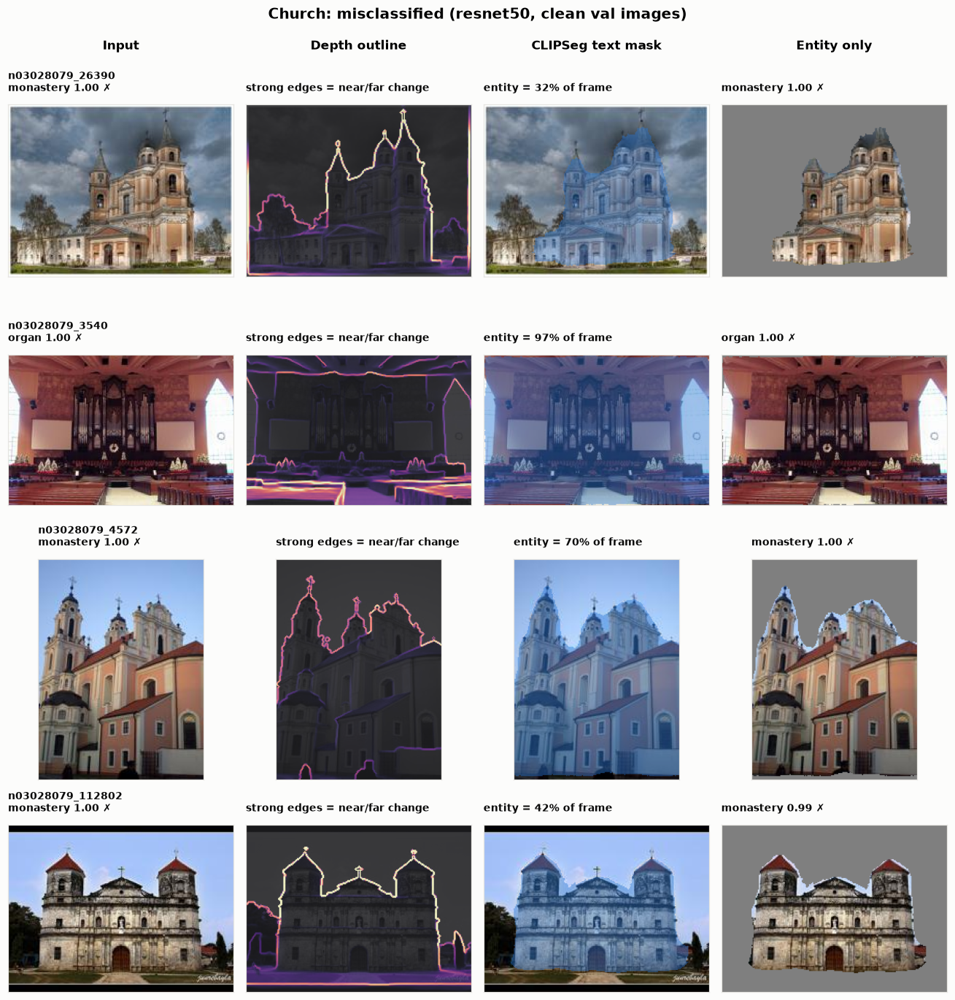
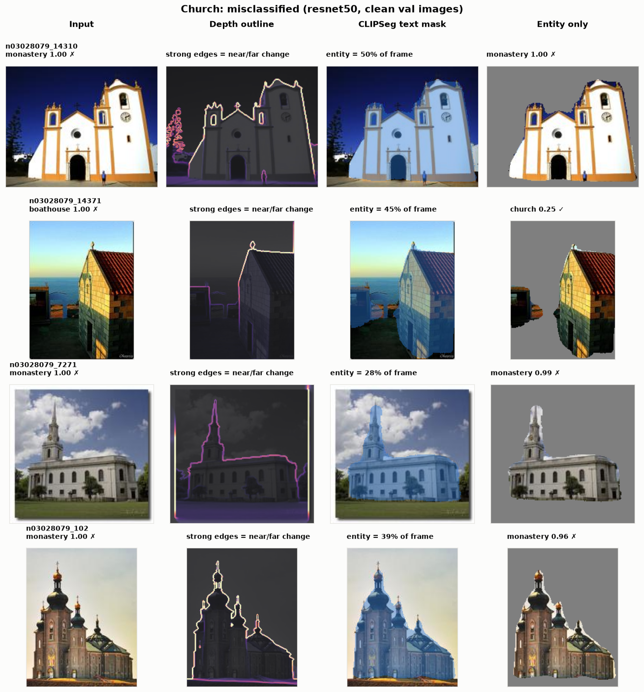
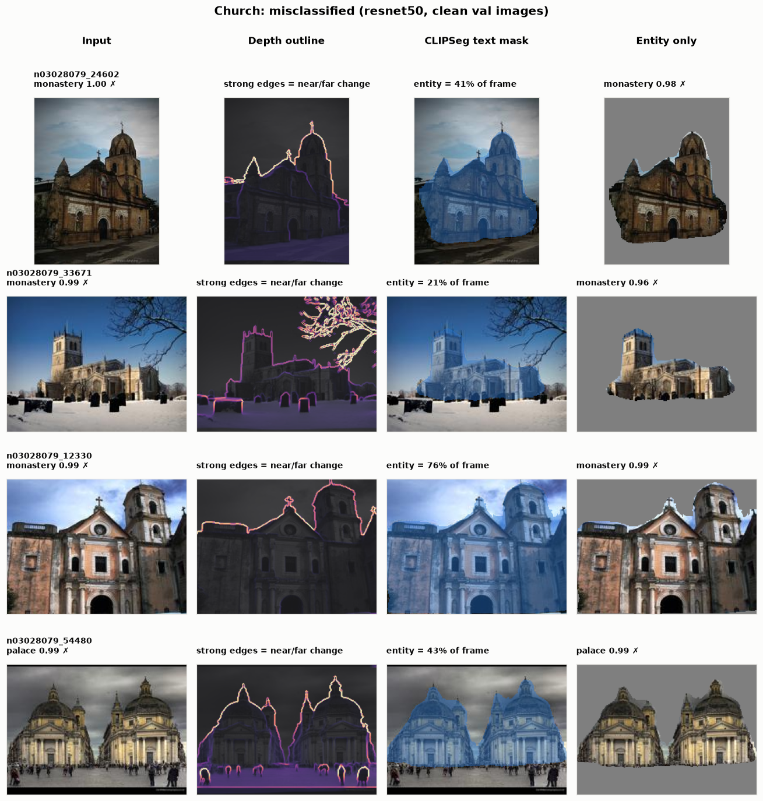
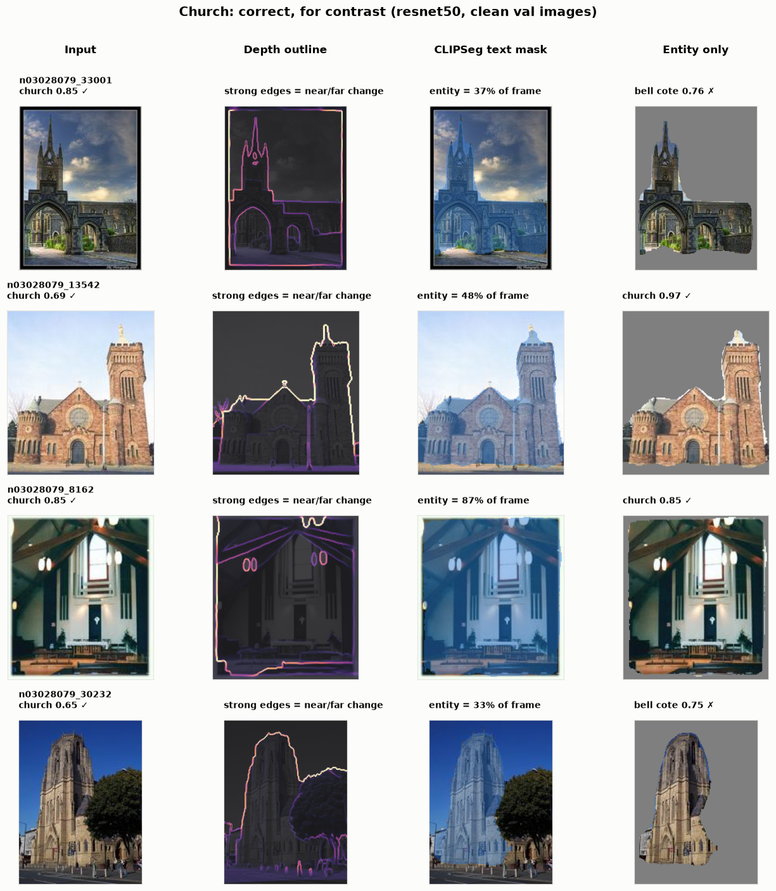

# Church failure gallery

Why does the frozen ResNet-50 get only 31% of the clean church validation images right? `scripts/failure_gallery.py` classifies all 409 church val images, then shows the most confidently wrong ones as rows of:

input | depth outline | entity mask | entity only (background grayed out)

The last column tests the "information removal" spatial instruction: if the background is what confuses the classifier, removing it should help.

## How the entity is found

`--entity-source` picks how the church is cut out:

| Source | What it does | Mask quality |
|---|---|---|
| `sam` | the existing `select_entity` pick (large, central, confident SAM region) | Often wrong for churches: picks a window, a door or the sky |
| `clipseg` | text-prompted mask from CLIPSeg (`CIDAS/clipseg-rd64-refined`, prompt "a church") | Covers the whole building |
| `sam_text` | union of SAM regions that fall mostly inside the CLIPSeg mask | Breaks the church into small pieces |

## Results (resnet50, 409 clean church val images)

| Entity source | Entity found | Accuracy, entity only | Fixed | Broken | Run time |
|---|---|---|---|---|---|
| none (full image) | n/a | **30.8%** | n/a | n/a | n/a |
| `sam` | 100% | 6.8% | 17 | 115 | about 30 min |
| `clipseg` | 97.6% | **24.4%** | 21 | 47 | about 1 min |
| `sam_text` | 96.3% | 5.4% | 4 | 108 | about 78 min |

"Fixed" means wrong on the full image and right on the entity only. "Broken" means the reverse.

What the 283 failures are called instead:

| Predicted | Count | Share of failures |
|---|---|---|
| monastery | 145 | 51% |
| bell cote | 31 | 11% |
| vault | 21 | 7% |
| altar | 18 | 6% |
| castle | 10 | 4% |
| palace | 10 | 4% |
| beacon | 7 | 2% |
| boathouse | 5 | 2% |

## Takeaways

1. **The background is not the main problem.** With a good mask (CLIPSeg), accuracy drops from 30.8% to 24.4% instead of rising. The most confident failures stay "monastery" at 0.99 to 1.00 even when only the building is left.
2. **Most failures are neighbouring ImageNet labels.** Monastery and bell cote are about 62% of the misses, and vault and altar come from interior photos. The frozen 1000-class head splits "church" across near-synonyms, which is a label problem, not a corruption problem.
3. **The unprompted SAM entity pick is unreliable on churches.** It often keeps a window or the sky, so any church result that uses `StructureCache.entity_mask` (for example the SAM-vs-depth structure comparison) should be rechecked with the CLIPSeg source.
4. **SAM parts inside the text mask do not help.** At a 16-point grid, SAM returns parts, not the whole building, so the union misses most of the church and is much slower.

## Gallery (CLIPSeg source)






## Reproduce

```bash
python scripts/failure_gallery.py --sam-all --entity-source clipseg   # about 1 min
python scripts/failure_gallery.py --sam-all --entity-source sam       # about 30 min on an RTX 3050
python scripts/failure_gallery.py --sam-all --entity-source sam_text  # about 78 min
```

Outputs go to `results/failure_gallery/church[_<source>]/`: `predictions.csv`, `confusions.csv`, `cases.csv`, `summary.json` and `gallery_*.png`. Use `--class-name` for another Imagenette class.
